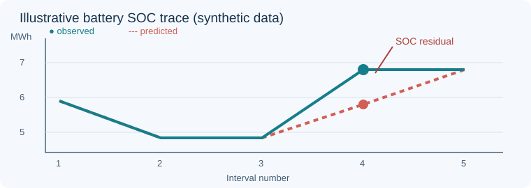

# SOC Ledger

*Trace the energy. Trust the schedule.*

| Topic | Details |
| --- | --- |
| Status | Development preview (unreleased; v0.1.0 package metadata) |
| Runtime | Python 3.10+; standard-library runtime |
| License | [MIT](LICENSE) |
| Documentation | [Usage](#usage) · [Synthetic examples](examples/) · [Assumptions](#assumptions-and-limitations) |
| Tests | [Local test command](#contributing) · [GitHub Actions configuration](.github/workflows/test.yml) |
| Citation | [How to cite](#citing) |

**SOC Ledger** is a small, read-only quality gate for CSV battery energy-storage dispatch schedules. It checks whether a reported end-of-interval stored-energy trajectory is consistent with explicit UTC intervals, AC-side charge/discharge powers, declared one-way efficiencies, power ratings and energy capacity. Intended for modelers reviewing schedules *before* optimization comparisons or reports.

Unlike a full optimization engine such as [PyPSA](https://pypsa.org/), this tool has no solver, database, pandas dependency or dispatch-control capabilities. It is a transparent validator, **not** a novel energy-balance method or a substitute for plant telemetry/BMS validation. Related battery QA software exists (for example, [BatteryLog](https://github.com/CANWECAN/BatteryLog)); uniqueness has not been established.

## Installation

From a repository checkout:

```sh
python -m pip install -e .
```

## Usage

All intervals have explicit UTC **start** timestamps and positive durations. Required columns: `interval_start_utc,duration_h,charge_mw,discharge_mw,soc_end_mwh`. `soc_end_mwh` is the **end-of-interval** stored energy. Charge and discharge powers are nonnegative and refer to the AC side. The first interval starts at the supplied initial SOC.

```sh
python -m soc_ledger examples/dispatch.csv --capacity-mwh 10 --max-charge-mw 2 --max-discharge-mw 2 --initial-soc-mwh 5
```

Expected JSON includes `"status": "PASS"`, `"intervals": 5` and `"findings": []`. A deliberately inconsistent example:

```sh
python -m soc_ledger examples/dispatch-with-errors.csv --capacity-mwh 10 --max-charge-mw 2 --max-discharge-mw 2 --initial-soc-mwh 5
```

This second command returns exit code **1**, with `SOC_RESIDUAL` and `SIMULTANEOUS` findings. Input/schema errors return **2**; valid schedules return **0**. JSON goes to stdout for valid CSVs and stderr for invalid input. Output includes interval-level predicted SOC and residuals. No input files are modified.



*Figure: synthetic illustration of a 1 MWh SOC mismatch; this is not field validation.*

## How the checks work

For each **contiguous** interval of duration Δt hours, SOC in MWh should satisfy:

`SOC_end = SOC_previous + charge_efficiency × charge_MW × Δt − discharge_MW × Δt / discharge_efficiency`

The default charge/discharge efficiencies are **0.95 each** (an *illustrative assumption*, not a universal battery specification); set them explicitly for your model. The default absolute residual tolerance is 0.01 MWh. Checks flag residuals, power ratings, capacity bounds, simultaneous charge/discharge and gaps/overlaps. A gap/overlap invalidates the next energy-balance residual rather than guessing unobserved flows; later contiguous intervals resume checking from observed SOC.

The equation follows standard storage modeling conventions, including [PyPSA's storage-unit balance](https://pypsa.readthedocs.io/en/v0.31.0/user-guide/optimal-power-flow.html). [NREL's System Advisor Model dispatch documentation](https://samrepo.nlr.gov/help/battery_dispatch_fom.html) describes the role of SOC limits in storage dispatch.

## Reproducible microbenchmark

```sh
python examples/benchmark.py
```

This script creates a temporary synthetic 8,760-row CSV, audits it 15 times, and reports the median local runtime. A reference run in the build environment on October 22, 2026 took **117 ms median** (15 runs; 0 findings). This is a small illustrative timing, **not** a hardware-independent throughput claim or real-data validation.

## Assumptions and limitations

- Fixed capacity and one-way efficiencies; no standby losses, auxiliary loads, temperature effects, degradation, inflows or hidden charge/discharge paths. Such omitted flows can create legitimate residuals.
- One signed net-power column is **not** accepted; explicit separate nonnegative charge/discharge columns prevent ambiguity.
- Interval durations must be supplied; the validator does not infer them from timestamps or resolve local daylight-saving transitions. Only explicit `Z` or `+00:00` timestamps are accepted.
- No plant telemetry, market data, safety limits, operational certification or real-world benchmarks have been validated. The bundled datasets are synthetic.
- Reports are diagnostic flags, not claims of fraud, infeasibility of all dispatch formulations or battery hardware faults.

## Contributing

Focused bug reports, clearer docs, reproducible test cases and additional documented model assumptions are welcome. Collaborators can [open an issue](https://github.com/mattjenkins3/soc-ledger/issues) with a synthetic minimal example, expected and observed behavior, and the commit tested. Avoid proprietary telemetry.

```sh
python -m pip install -e .
python -m unittest discover -s tests -v
```

For a pull request, explain the issue, add regression tests for behavioral changes, and run the test suite. Discuss significant modeling extensions before implementation.

## Citing

If SOC Ledger supports your work, cite **SOC Ledger contributors, *SOC Ledger* (software), the specific Git commit used**, and the repository address `https://github.com/mattjenkins3/soc-ledger`, including an access date where appropriate. No archival DOI, published release, or peer-reviewed paper is claimed. The `0.1.0` package version alone is not a reproducible release identifier.

## License

SOC Ledger is provided under the [MIT License](LICENSE).
